<p align="center">
  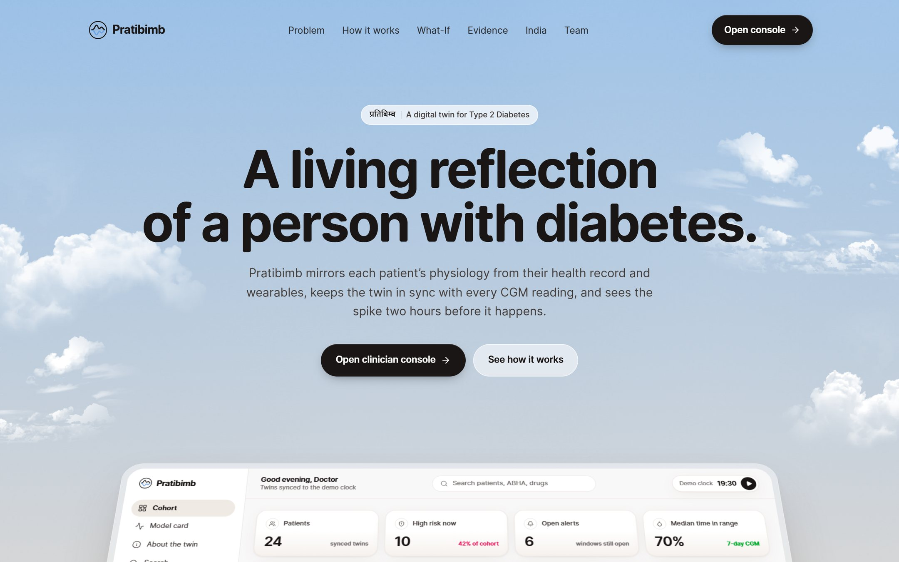
</p>

<h1 align="center">Pratibimb (प्रतिबिम्ब)</h1>

<p align="center">
  <b>A hybrid physiology + machine-learning digital twin for Type 2 Diabetes, built for India.</b><br>
  Happiest Health <b>Digital Twin Challenge 2026</b> · Team <b>Stack Underflow</b> · BIT Mesra, Off Campus Jaipur
</p>

<p align="center">
  <a href="VIDEO_URL">Video (20+ min)</a> ·
  <a href="https://pratibimb-omega.vercel.app">Live demo</a> ·
  <a href="StackUnderflow_BIT-Mesra-Jaipur/Pratibimb_Architecture.pdf">Architecture (PDF)</a> ·
  <a href="StackUnderflow_BIT-Mesra-Jaipur/Pratibimb_Presentation.pdf">Presentation (PDF)</a> ·
  <a href="docs/MODEL_CARD.md">Model card</a> ·
  <a href="docs/DATA_CARD.md">Data card</a> ·
  <a href="docs/API.md">API</a>
</p>

> **All data in this project are synthetic. Pratibimb is a research proof of concept, not a medical device.**
> Alerts and recommendations are illustrative and must not be used for clinical decisions.

---

## Contents

1. [The 30-second summary](#the-30-second-summary)
2. [Team](#team)
3. [Problem statement and healthcare use case](#problem-statement-and-healthcare-use-case)
4. [What makes it a real twin](#what-makes-it-a-real-twin)
5. [Built for India](#built-for-india)
6. [Architecture](#architecture)
7. [Data: synthetic and sandbox-compliant](#data-synthetic-and-sandbox-compliant)
8. [The model](#the-model)
9. [Results](#results)
10. [Demo walkthrough](#demo-walkthrough)
11. [How to run](#how-to-run)
12. [Tech stack and AI/ML details](#tech-stack-and-aiml-details)
13. [Submission checklist and links](#submission-checklist-and-links)
14. [Licence](#licence)
15. [Acknowledgements and citations](#acknowledgements-and-citations)
16. [Disclaimer](#disclaimer)

---

## The 30-second summary

**Pratibimb** ("reflection") gives each person with Type 2 Diabetes a virtual twin that a clinician can watch, question and test advice on.

- **Record:** the twin is personalised from the patient's EHR, exported as an **HL7 FHIR R4** Bundle with an ABHA-format ID: HbA1c, fasting glucose, the TyG index, waist/height, diabetes duration and medications.
- **Sense:** it ingests **CGM every 5 minutes** plus heart rate, HRV, steps and sleep stages from a wearable, and the meals and doses the patient logs, from a table of 73 Indian foods.
- **Mirror:** a compact glucose–insulin model (an extended Bergman minimal model) is **kept in sync by an Ensemble Kalman Filter**. With every reading it re-estimates hidden physiology: insulin sensitivity, beta-cell response, liver glucose output, meal absorption and the dawn effect.
- **Foresee:** the synced twin forecasts glucose **4 hours ahead with an uncertainty cone**. A LightGBM layer turns that forecast into **calibrated, explained alerts**: level-2 hyperglycaemia within 2 h, hypoglycaemia within 1 h, and nocturnal hypoglycaemia tonight. A **What-If Lab** shows what a meal swap, a walk, a skipped dose or a short night would do to *this* patient.

Headline results on 36 held-out synthetic test patients (from [`reports/metrics.json`](reports/metrics.json)):

| task | AUROC | AUPRC | median lead time |
|---|---|---|---|
| `hyper_2h`: >250 mg/dL within 2 h | 0.9368 | 0.7087 | 80.0 min |
| `hypo_1h`: <70 mg/dL within 1 h | 0.9855 | 0.3244 | 35.0 min |
| `nocturnal_hypo`: hypo tonight, predicted at bedtime | 0.9379 | 0.1504 | 185.0 min |

The 4-hour forecast has a 30-minute RMSE of 29.76 mg/dL, against 41.89 for linear extrapolation, and puts 92.95 % of 30-minute forecasts in Parkes zone A. The test patients came from a **richer simulator than the twin**, so the twin is not graded on its own assumptions. That is still not evidence of performance on real people; see [Limitations](#honest-limitations).

## Team

**Team name:** Stack Underflow

| Member | Role | Programme | College |
|---|---|---|---|
| **Yashvardhan Thanvi** | Team leader | Bachelor of Computer Applications (BCA), final year | Birla Institute of Technology (BIT Mesra), Off Campus Jaipur |
| **Devesh Jain** | Team member | Bachelor of Computer Applications (BCA), final year | Birla Institute of Technology (BIT Mesra), Off Campus Jaipur |

| | |
|---|---|
| College / incubator | Birla Institute of Technology (BIT Mesra), Off Campus Jaipur, Rajasthan, India |
| Challenge | Happiest Health Digital Twin Challenge 2026 (Unstop) |
| Chronic condition | Type 2 Diabetes |
| Project title | **Pratibimb: a hybrid physiology + ML digital twin for Type 2 Diabetes** |

## Problem statement and healthcare use case

### The problem in India

- **Scale.** The ICMR-INDIAB-17 national survey estimates diabetes prevalence in India at **11.4 % (~101 million adults)**. A further **15.3 % (~136 million)** have prediabetes, **35.5 %** have hypertension and **39.5 %** have abdominal obesity (Anjana RM et al., *Lancet Diabetes & Endocrinology* 2023).
- **Sparse data.** Glucose changes every few minutes, but clinic data arrive every few months. CGM and wearables can fill the gap, but no clinician can watch every stream.
- **Different phenotypes.** Asian Indian T2D splits into data-driven subgroups: severe insulin-deficient (**SIDD**), severe insulin-resistant (**SIRD**), mild age-related (**MARD**) and insulin-resistant obese (**IROD**). India also has a "thin-fat" phenotype with normal BMI but central adiposity (INSPIRED cohort; Anjana RM et al., *BMJ Open Diabetes Research & Care* 2020). A single population model does not fit them all.
- **Different plates and risks.** Carbohydrate-heavy meals, evening chai with a snack, late dinners and festival sweets drive the spikes. Sulfonylureas are widely prescribed, and a fasting day (Navratri, Ekadashi, Ramadan) combined with a sulfonylurea dose is a classic hypoglycaemia trap.

### The healthcare use case

A physician or diabetologist follows a panel of people with T2D who wear a CGM and a wrist wearable. Pratibimb supports three jobs:

1. **Triage:** the cohort view ranks every synced twin by *calibrated* risk, so the clinician knows who needs a call now.
2. **Understand:** the virtual patient shows the CGM against the twin, a 4-hour forecast cone, the twin's current physiology, and the reasons behind each risk in plain language (for example "time since sulfonylurea dose" or "twin forecast +2 h (high)").
3. **Counsel:** before advising, the clinician tests the advice on the patient's own twin: bajra roti instead of rice, a 15-minute walk after dinner, a skipped or shifted glimepiride dose, a short night's sleep.

The brief's example, *"predict a sudden glucose spike 2 hours in advance"*, is our `hyper_2h` task. We add two hypoglycaemia tasks because lows are what make sulfonylurea and insulin therapy dangerous.

## What makes it a real twin

A risk classifier tells you a number. A digital twin is a model of *this* patient that stays in sync with them and can be asked counterfactual questions. Pratibimb does both:

| | Plain risk classifier | Pratibimb |
|---|---|---|
| Personalised physiology (insulin sensitivity, beta-cell response, liver output) | no | yes, as EnKF posteriors with uncertainty |
| Stays in sync with the patient | retrained offline | Ensemble Kalman Filter update on every CGM reading |
| Forecast with uncertainty | no | 64-member ensemble cone (p05–p95) to +4 h |
| "What if?" on this patient | no | meals, walk, skip/shift a dose, sleep → baseline vs scenario |
| Explanations | sometimes | TreeSHAP drivers + the twin's physiological state |

**Avoiding the "inverse crime".** Synthetic patients are produced by a separate **truth simulator** that is deliberately richer than the twin. It has drifting and diurnal insulin sensitivity, illness and stress episodes, hepatic insulin suppression, counter-regulation, unlogged snacks, meal-logging errors, missed doses and CGM lag, drift, noise, compression lows and dropouts. The twin only sees what a real system would see: CGM, wearable signals, *logged* meals and doses, and the EHR. It never sees true plasma glucose or the subtype label. All evaluation is twin-vs-truth on held-out patients.

## Built for India

| | |
|---|---|
| **ABDM-ready records** | HL7 FHIR R4 Bundles (the ABDM record format) with ABHA-format identifiers, LOINC labs and SNOMED CT conditions |
| **73 Indian foods** | Katori / roti / piece portions with Hindi names, carbs, fibre, protein, fat, GI and GL, approximated from IFCT 2017 and the International GI Tables, with an honest `source` column |
| **INSPIRED subtypes** | Cohort archetypes SIDD / SIRD / MARD / IROD, including the "thin-fat" phenotype and Asian BMI cut-offs (23 / 25 kg/m²) |
| **Sulfonylurea safety** | Fasting days with a sulfonylurea dose are simulated; "time since sulfonylurea dose" is a top driver of hypo alerts; the What-If Lab shows what skipping or shifting a dose does |
| **Indian day** | Late dinners, evening chai + snack, festival sweets and region-flavoured meal templates (North / South / West / East) |
| **Routine labs only** | Insulin resistance from the TyG index (fasting insulin is rarely measured in India); baseline glucose from HbA1c via ADAG |

<p align="center">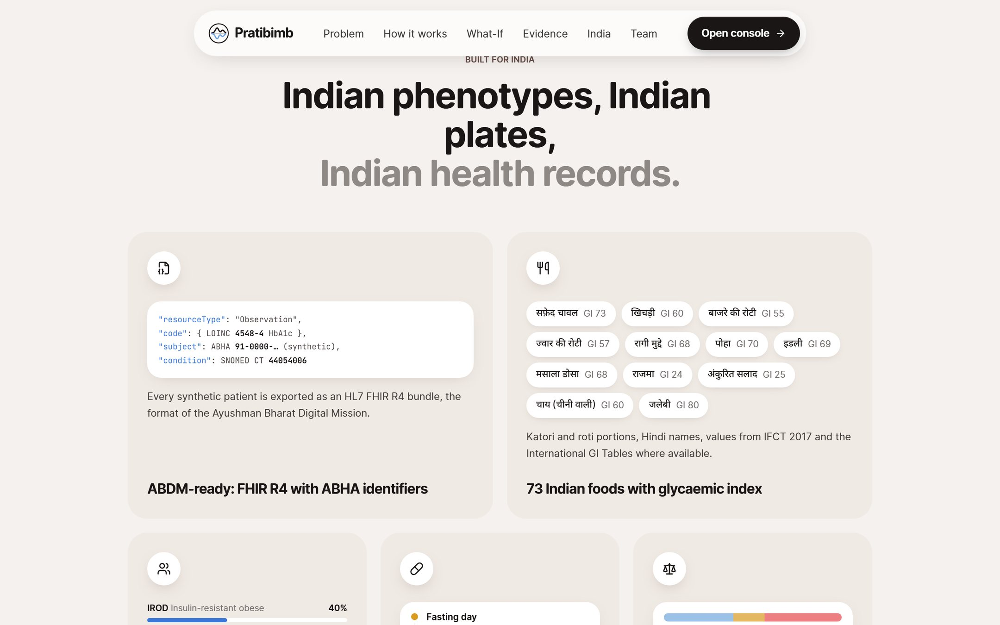</p>

## Architecture

<p align="center">
  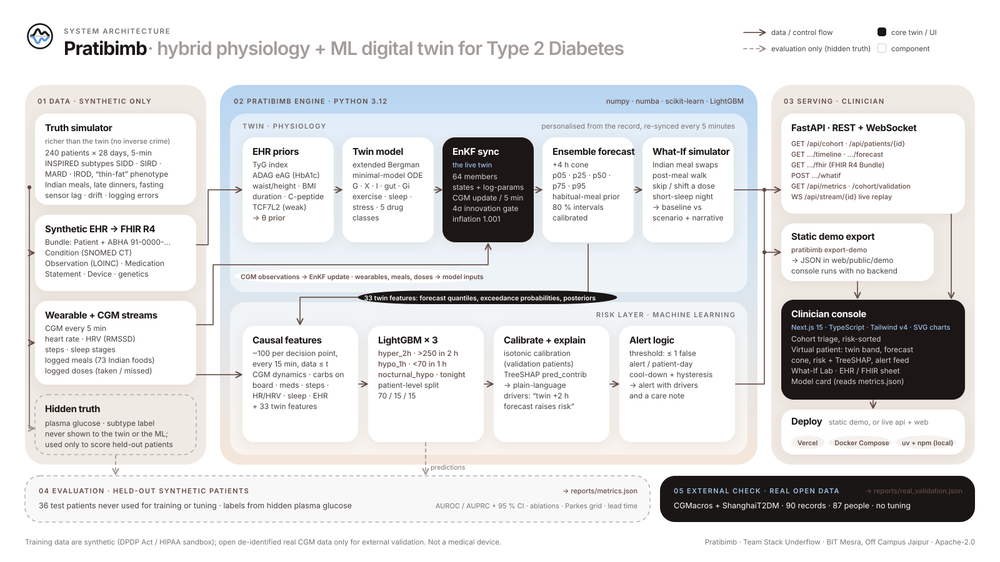
</p>

PDF with a component reference: [`StackUnderflow_BIT-Mesra-Jaipur/Pratibimb_Architecture.pdf`](StackUnderflow_BIT-Mesra-Jaipur/Pratibimb_Architecture.pdf). Source: [`docs/architecture.svg`](docs/architecture.svg).

**Flow:**

1. The truth simulator emits a synthetic EHR (as FHIR R4) and wearable/CGM streams, and keeps the true glucose and subtype hidden.
2. EHR priors initialise the twin's parameters. The EnKF keeps the twin in sync with CGM. The ensemble forecasts 4 h ahead and powers the What-If simulator.
3. About 100 causal features, 33 of them from the twin, feed three LightGBM models. Isotonic calibration, TreeSHAP and alert logic follow.
4. Results are served by FastAPI (REST + WebSocket replay), or by a static JSON export, to the Next.js clinician console.
5. Evaluation scores everything on held-out patients against the hidden truth and writes `reports/metrics.json`.

```
Pratibimb/
  engine/                    Python package `pratibimb` (uv, Python 3.12)
    pratibimb/
      cohort/                truth simulator, archetypes, Indian lifestyle, wearables, CGM sensor, EHR, FHIR R4
      physiology/            twin ODE (extended Bergman minimal model), drug kinetics, numba kernels
      foods/                 Indian food table (73 items, Hindi names, GI/GL, source column)
      twin/                  EHR priors, EnKF sync, ensemble forecasts, inferred subtype
      ml/                    causal features, labels, LightGBM + calibration, TreeSHAP, alerts, evaluation, Parkes grid
      api/                   FastAPI app (REST + WebSocket), what-if service
      reports/               cohort validation + figures
      cli.py · export.py     `pratibimb generate|assimilate|train|evaluate|export-demo|serve|build`
    tests/                   physiology, EnKF, leakage, labels, FHIR, API, what-if, Parkes
  web/                       Next.js 15 landing page + clinician console (static demo export in public/demo)
  reports/                   metrics.json, cohort_validation.json, figures/
  docs/                      MODEL_CARD, DATA_CARD, API, architecture.svg, screenshots/, deck/ (deck + diagram sources)
  StackUnderflow_BIT-Mesra-Jaipur/   submission folder: architecture PDF, presentation PDF/PPTX, video link
  docker-compose.yml         api + web
```

## Data: synthetic and sandbox-compliant

No real patient data were used. The cohort was generated by `pratibimb generate` (deterministic seed 20261020), in line with the challenge's sandbox rules (DPDP Act 2023 / HIPAA: anonymised, open or synthetic data only). Full details are in the [data card](docs/DATA_CARD.md).

| Stream | Contents |
|---|---|
| **Static: EHR** | Demographics; 2 years of labs (HbA1c, fasting glucose, lipids incl. TG/HDL, creatinine/eGFR, ALT, urine ACR, fasting C-peptide for ~35 %); comorbidities; medications (metformin, sulfonylureas, DPP-4 inhibitors, SGLT2 inhibitors, basal insulin); synthetic genetic markers (TCF7L2 rs7903146 genotype, polygenic-risk percentile) |
| **Dynamic: wearable / IoT** | CGM every 5 min (lag, calibration drift, AR(2) noise, compression lows, dropouts); heart rate; HRV (RMSSD); steps; sleep stages; logged meals and doses, with realistic logging errors |

**FHIR R4 and ABHA.** Each patient is exported as an HL7 FHIR R4 `collection` Bundle, the record format used by the Ayushman Bharat Digital Mission. The Bundle holds a Patient with an obviously synthetic ABHA-format identifier (`91-0000-…`); Conditions coded in SNOMED CT (e.g. 44054006 Type 2 diabetes mellitus); lab and vital Observations coded in LOINC (e.g. 4548-4 HbA1c, 1558-6 fasting glucose, 2571-8 triglycerides); MedicationStatements; and a Device with wearable summaries. Names are random combinations of common Indian given names and surnames.

**Cohort** (from `reports/metrics.json` → `dataset`):

| patients | days | train / val / test patients | CGM points | subtype counts (hidden truth labels) |
|---|---|---|---|---|
| 240 | 28 | 168 / 36 / 36 | 1913090 | SIDD 65 · SIRD 33 · MARD 46 · IROD 96 |

**Realism checks** (from `reports/cohort_validation.json` → `checks`):

| check | result | target |
|---|---|---|
| cohort-median time in range 70–180 mg/dL | 68.7 % | ~55–75 % |
| median glucose CV | 29.0 %; 78.3 % of patients within 20–36 % | mostly 20–36 % |
| share of hypoglycaemia episodes in sulfonylurea / insulin users | 97.0 % | concentrated in SU / insulin users |
| mean CGM glucose vs ADAG eAG from HbA1c | r = 0.914, median difference −1.9 mg/dL | consistent |

## The model

### 1. Twin model (what the twin runs)

The twin's state is plasma glucose `G`, remote insulin action `X`, plasma insulin `I`, two gut compartments `D1, D2` and interstitial glucose `Gi`, which is what the CGM sees. It runs with a 1-minute internal step and 5-minute observations. Simplified from the [model card](docs/MODEL_CARD.md):

```
dG/dt  = -(SG + X)·G + EGP·f_EGP(t) + Ra(t)/V_G - k_ex·e(t)·G - k_r·max(G - G_thr, 0)
dX/dt  = -p2·X + p2·SI·m_sleep·m_stress·m_ex(t)·I
dI/dt  = -n·I + beta·max(G - h, 0)·(sulfonylurea, DPP-4 effects) + I_exo(t)/V_I
dD1/dt = -D1/tau + CHO_in(t);   dD2/dt = (D1 - D2)/tau;   Ra = f_bio·D2/tau   (tau from GI, fat, protein, fibre)
dGi/dt = (G - Gi)/tau_i                                                        (tau_i = 9 min)
```

- **Wearables feed the physiology.** Steps drive exercise glucose uptake and a temporary insulin-sensitivity boost. A short night lowers insulin sensitivity the next day by up to 20 %, in the 15–25 % range reported in sleep-restriction studies. Stress (resting HR above, and HRV below, the personal 7-day baseline) raises liver glucose output.
- **Drugs.** Metformin lowers liver glucose output. Sulfonylureas add insulin secretion, part of it glucose-independent, which is the hypoglycaemia risk when a meal is skipped. DPP-4 inhibitors boost post-meal secretion. SGLT2 inhibitors lower the renal threshold from 180 to 105 mg/dL. Glargine is modelled as a slow depot.

### 2. EHR → priors

The personalised parameters are θ = {S_I, S_G, β, EGP, meal rate, dawn}. Their priors come from routine labs, because fasting insulin is rarely measured in India:

- **Insulin sensitivity S_I:** from the TyG index = ln(TG [mg/dL] × FPG [mg/dL] / 2), waist-to-height ratio and BMI.
- **Beta-cell response β:** from diabetes duration, HbA1c, C-peptide when present, and TCF7L2 genotype as a weak prior.
- **Basal liver output EGP:** solved so that the fasting steady state matches fasting glucose and the ADAG estimated average glucose, eAG = 28.7 × HbA1c − 46.7.

The twin never reads the subtype label. The console shows an *inferred* subtype computed from twin posteriors and the EHR.

### 3. EnKF assimilation (the "sync")

- A stochastic Ensemble Kalman Filter with **64 members** runs over an augmented state: 7 dynamic states plus 6 parameters in log/logit space, each following a slow random walk.
- Every 5 minutes the ensemble is propagated and then updated with the CGM reading, using observation sd = 5 + 6 % of the reading. A missing reading means no update.
- A 4σ innovation gate rejects compression artefacts; multiplicative inflation is 1.001; parameter bounds are enforced in transformed space.
- **Forecasts** propagate the ensemble 240 minutes ahead with prescribed doses and a **habitual-meal prior** learned from the patient's last 7 days of logged meals. The p10–p90 interval is rescaled per horizon so that it covers 80 % of truth on *validation* patients.

### 4. Risk layer (hybrid ML)

- **Decision points:** every 15 minutes, plus a bedtime decision for the nocturnal task.
- **Labels:** computed on hidden truth plasma glucose. `hyper_2h` is a level-2 hyper (>250 mg/dL for ≥15 min) starting within 120 min. `hypo_1h` is a hypo (<70 mg/dL for ≥15 min) starting within 60 min. `nocturnal_hypo` is any hypo between 00:00 and 06:00. A CGM-labelled variant is also reported.
- **Features:** about 100 strictly causal features (data ≤ t), including **33 twin features** such as ensemble forecast quantiles, exceedance probabilities, posterior parameters and their 24-h change, insulin action, gut glucose and innovation. A unit test checks for leakage: perturbing data after `t` leaves the features at `t` unchanged.
- **Model:** one **LightGBM** binary classifier per task, with class-imbalance weighting and early stopping on validation AUPRC, followed by **isotonic calibration** on validation patients. **TreeSHAP** contributions (`pred_contrib`) are mapped to clinician-readable drivers.
- **Alerts:** an alert fires when the probability crosses a threshold chosen on validation patients for **≤ 1 false alert per patient-day** (≤ 1 per patient-week for the nocturnal task). A cool-down and hysteresis keep one alert per event window.
- **Split:** patient-level 70/15/15, stratified by hidden archetype. Test patients are touched only by `evaluate`.

### 5. What-If Lab

From the synced ensemble at the current time, the What-If Lab simulates a baseline (the planned future) and a scenario using common random numbers. A scenario can add or swap Indian foods by portion, add a light or brisk walk, skip or shift a dose, or set last night's sleep. It returns quantile bands, peak, nadir, minutes above 180 and below 70, hypoglycaemia probability and time in range, plus narrative bullets computed from the deltas. No LLM is involved.

## Results

All numbers below are **copied verbatim from [`reports/metrics.json`](reports/metrics.json)**, generated on 2026-10-13 by `pratibimb build --profile full`. They are scored on the **36 held-out test patients**, which were generated by the richer truth simulator and never used for training or tuning. `ci95` is a patient-level bootstrap with 200 resamples.

### Early-warning tasks

| task | prevalence | AUROC (95 % CI) | AUPRC (95 % CI) | Brier | threshold | sensitivity | precision | alerts / patient-day | false alerts / patient-day | median lead (min) |
|---|---|---|---|---|---|---|---|---|---|---|
| `hyper_2h` | 0.1337 | **0.9368** (0.925–0.948) | **0.7087** (0.641–0.765) | 0.06346 | 0.4246 | 0.6334 | 0.4686 | 2.0526 | 1.0908 | 80.0 |
| `hypo_1h` | 0.0052 | **0.9855** (0.977–0.993) | **0.3244** (0.176–0.399) | 0.00403 | 0.052 | 0.425 | 0.0794 | 0.6625 | 0.6099 | 35.0 |
| `nocturnal_hypo` | 0.0085 | **0.9379** (0.903–0.983) | **0.1504** (0.054–0.232) | 0.00941 | 0.0303 | 0.875 | 0.0593 | 0.1261 | 0.1186 | 185.0 |

Sensitivity is per event: 1473 `hyper_2h` events and 120 `hypo_1h` events in the test set. The nocturnal task has one decision per night; there are 936 test nights, 8 of them positive.

**CGM-labelled variant** (the same predictions scored against CGM-derived labels): `hyper_2h` AUROC 0.9356 / AUPRC 0.6868; `hypo_1h` 0.9284 / 0.262; `nocturnal_hypo` 0.8023 / 0.2667. Hypoglycaemia scores are lower because CGM noise and compression artefacts create "events" that are not in the truth.

### Ablation: does the twin help?

Same test patients, same splits:

| model | hyper_2h AUROC | hypo_1h AUROC | nocturnal_hypo AUROC | hyper_2h AUPRC | hypo_1h AUPRC | nocturnal_hypo AUPRC |
|---|---|---|---|---|---|---|
| `cgm_linear`: CGM linear extrapolation | 0.6107 | 0.9441 | 0.8091 | 0.1861 | 0.0545 | 0.0406 |
| `ml_no_twin`: LightGBM without twin features | 0.924 | 0.9795 | 0.9283 | 0.6717 | 0.298 | 0.1253 |
| `twin_only`: twin ensemble probability alone | 0.837 | 0.739 | 0.7315 | 0.4998 | 0.0883 | 0.1291 |
| **`hybrid`: ML + twin features** | **0.9368** | **0.9855** | **0.9379** | **0.7087** | **0.3244** | **0.1504** |

The hybrid is best on every task. Brier scores from `brier_by_model` (hybrid / ml_no_twin / twin_only): `hyper_2h` 0.06346 / 0.06784 / 0.08257; `hypo_1h` 0.00403 / 0.00414 / 0.00488; `nocturnal_hypo` 0.00941 / 0.0108 / 0.00911. On Brier, the twin-only probability is slightly better for the nocturnal task.

<p align="center">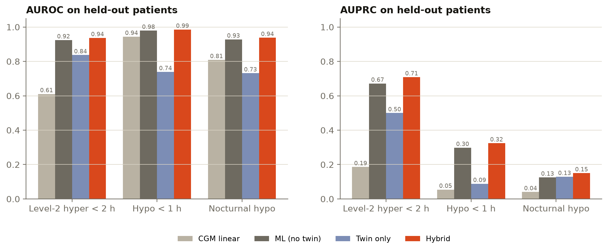</p>

### Forecast accuracy (twin ensemble median vs truth plasma glucose)

| horizon (min) | RMSE (mg/dL) | MARD (%) | 80 % interval coverage | Parkes A / B / C / D / E (%) | linear-extrapolation RMSE | persistence RMSE |
|---|---|---|---|---|---|---|
| 30 | **29.76** | 11.89 | 0.8111 | 92.95 / 6.66 / 0.39 / 0.0 / 0.0 | 41.89 | 36.25 |
| 60 | **37.81** | 14.58 | 0.8151 | 88.14 / 10.77 / 1.08 / 0.01 / 0.0 | 76.51 | 49.52 |
| 120 | **40.47** | 16.7 | 0.8178 | 84.31 / 14.53 / 1.15 / 0.01 / 0.0 | 140.56 | 60.27 |

Each horizon is scored on 93024 forecast points. Raw ensemble intervals were too narrow (`coverage_80_raw` 0.3641 / 0.3898 / 0.4275). They were widened by validation-fitted factors (`interval_scale` 3.103 / 2.991 / 2.783) to reach the coverage shown.

<p align="center">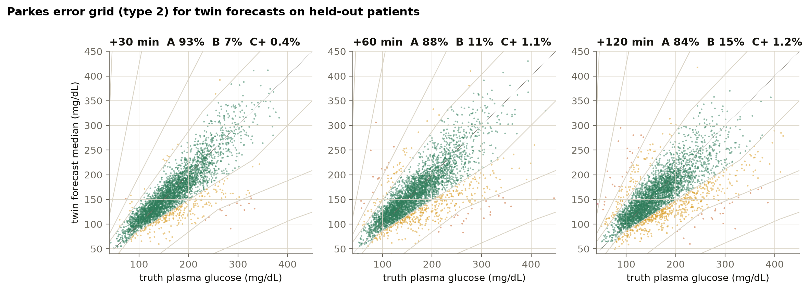</p>

### Sync quality

From `metrics.json` → `sync`: twin vs truth MARD **9.38 %**, raw CGM vs truth MARD **8.51 %**, twin band 80 % coverage **0.5866**.

<p align="center">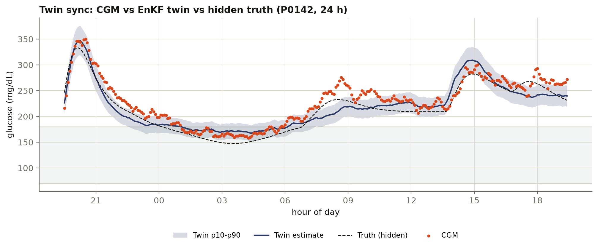</p>

### Top TreeSHAP drivers

The top three drivers per task, by mean |contribution| in `top_features`:

| task | top drivers |
|---|---|
| `hyper_2h` | Twin: chance of >250 within 2 h (0.6362) · Time of day (0.5727) · Twin forecast +2 h (high) (0.3858) |
| `hypo_1h` | Current glucose (CGM) (0.4073) · Twin: forecast low in next 2 h (0.1758) · Time since sulfonylurea dose (0.1736) |
| `nocturnal_hypo` | Twin: expected overnight mean (0.4501) · Basal insulin action (0.2082) · Time since sulfonylurea dose (0.2068) |

More figures are in [`reports/figures/`](reports/figures): calibration, lead-time histograms, forecast cone, AGP by subtype, time-in-range distribution, hypoglycaemia by medication class, and post-prandial peaks.

### Honest limitations

- **Synthetic data only.** Good scores show the method works *if the world resembles our simulator*. Real CGM and EHR validation is required before any clinical claim.
- **Same model family.** The truth simulator is richer than the twin but belongs to the same minimal-model family. Real physiology will be further from the twin than our test patients are.
- **The twin does not denoise CGM.** The filtered twin is slightly *less* accurate than raw CGM against truth (9.38 % vs 8.51 % MARD), because the EnKF cannot remove correlated sensor drift. Its value is in forecasting and in the features it feeds the risk models.
- **Effective parameters.** Posterior S_I and β are "effective" values that compensate for model mismatch. Use them as trends, not lab measurements.
- **Rare events.** Hypoglycaemia alerts have low precision (0.0794 for `hypo_1h`), so alert fatigue is a real risk. The nocturnal metrics rest on 8 positive test nights, so their confidence intervals are wide.
- **Rough subtypes.** The inferred subtype agrees with the hidden archetype 50.8 % of the time (`subtype_inference.accuracy` = 0.508). It is a rough phenotype, never a diagnosis.
- **Approximate inputs.** Food GI and composition values are approximate, some are estimates, and meal logging is assumed to be timely.

## Demo walkthrough

The console runs at a fixed **demo clock** of Mon 12 Oct 2026, 19:30 IST (day 21 of 28), so every patient has history behind them and a recorded future to replay live. The static demo export ships 24 patients: 23 held-out test patients and 1 validation patient. Screenshots below are from a production build (`next build && next start`) at 1440 × 900.

<table>
<tr>
<td width="50%">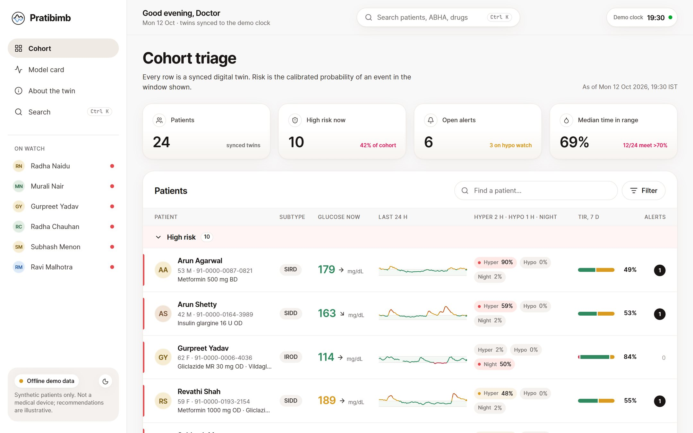<br><b>1. Cohort triage.</b> Every row is a synced twin, ranked by calibrated risk, with a 24-h sparkline, current glucose and trend, risk chips, time in range and open alerts.</td>
<td width="50%">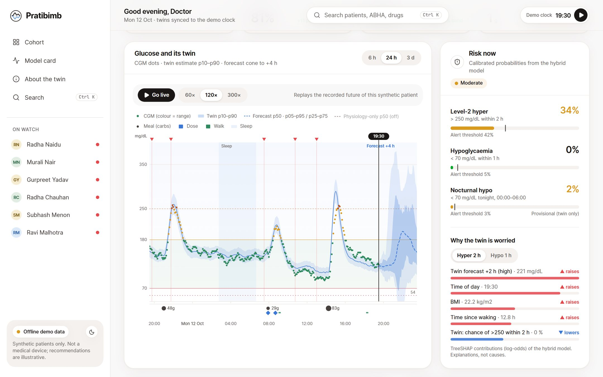<br><b>2. Virtual patient.</b> CGM dots, the twin band (p10–p90) and a forecast cone to +4 h, with meals, doses, walks and sleep marked. "Go live" replays the future at 60×, 120× or 300×.</td>
</tr>
<tr>
<td>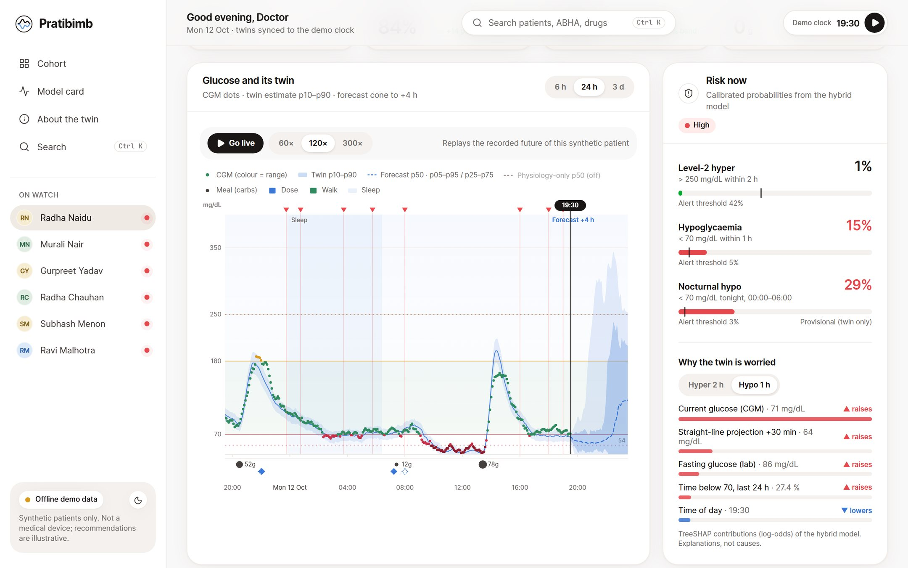<br><b>3. Why the twin is worried.</b> Calibrated risks with alert thresholds, and TreeSHAP drivers in plain language (this patient: hypo 1 h 15 %, nocturnal 29 %).</td>
<td>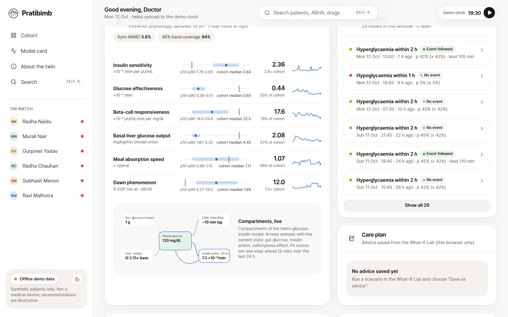<br><b>4. Inside the twin.</b> Posterior physiology (insulin sensitivity, beta-cell response, liver output, dawn effect) against the cohort median, 7-day trends, a live compartment schematic and the alert feed.</td>
</tr>
<tr>
<td>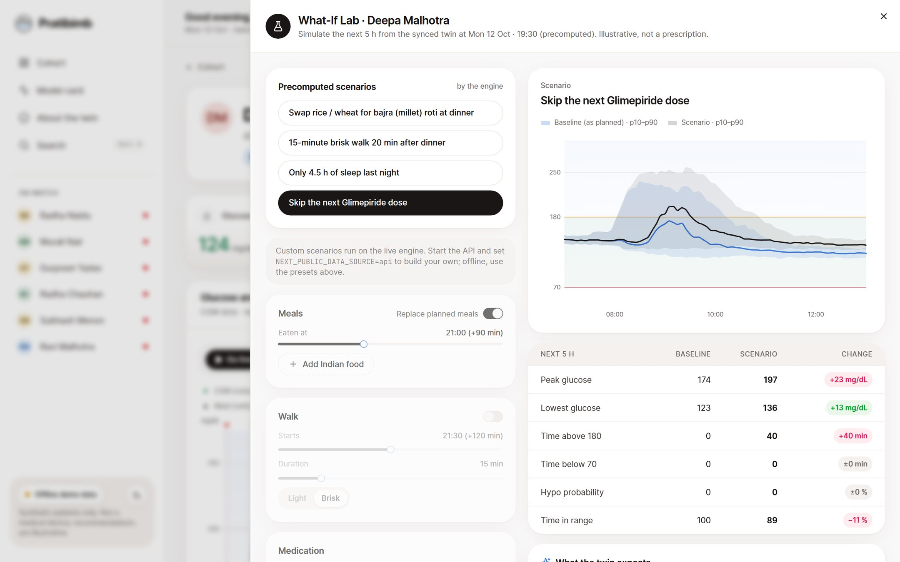<br><b>5. What-If Lab.</b> Skipping the next glimepiride dose for P0029: peak 174 → 197 mg/dL, 40 more minutes above 180 (engine preset). Indian food picker, walk, dose and sleep controls.</td>
<td>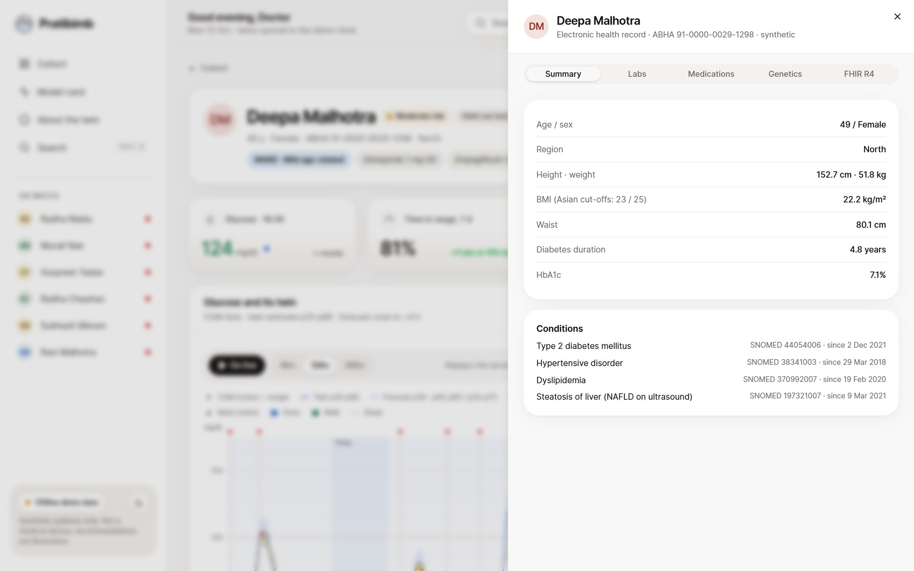<br><b>6. EHR · FHIR sheet.</b> Summary, labs (LOINC), conditions (SNOMED CT), medications, genetics and the raw FHIR R4 Bundle with the ABHA-format identifier.</td>
</tr>
<tr>
<td>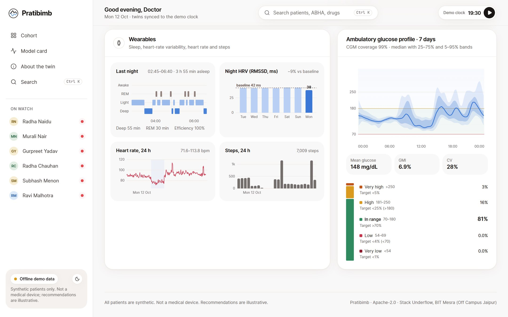<br><b>7. Wearables and AGP.</b> Last night's hypnogram, HRV against baseline, heart rate and steps, plus the standard ambulatory glucose profile and time-in-range bar.</td>
<td>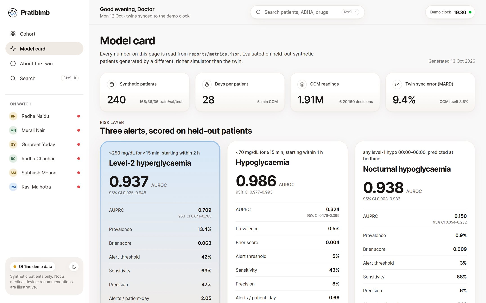<br><b>8. Model card.</b> Every number is read from <code>metrics.json</code> and <code>validation.json</code>: task metrics, ablation, calibration, lead times, Parkes zones, cohort realism and limitations.</td>
</tr>
</table>

What-If preset results from the engine's demo export (next 5 h):

| patient (synthetic) | scenario | result |
|---|---|---|
| P0029 (glimepiride + empagliflozin) | skip the next glimepiride dose | peak 174.0 → 196.7 mg/dL; time >180: 0 → 40 min; TIR 100 % → 88.9 % |
| P0029 | 15-min brisk walk 20 min after dinner | peak 204.0 → 199.1 mg/dL; time >180: 65 → 55 min |
| P0098 (hypo-prone) | swap to bajra (millet) roti at dinner | peak 166.3 → 150.3 mg/dL |
| P0098 | skip the next glimepiride dose | hypo probability 0.891 → 0.828; time <70: 90 → 80 min |

## How to run

**Requirements:** Python 3.12 with [uv](https://docs.astral.sh/uv/), and Node 22 with npm. Docker is optional. The commands below come from [`engine/README.md`](engine/README.md) and [`web/README.md`](web/README.md).

### 1. Engine (Python)

```bash
cd engine
uv venv .venv --python 3.12
uv pip install --python .venv/Scripts/python.exe -e ".[dev]"      # Windows
# uv pip install --python .venv/bin/python -e ".[dev]"            # Linux / macOS
```

Activate the venv (or call `.venv/Scripts/python -m pratibimb …`), then:

```bash
pratibimb build --profile full                      # generate + assimilate + train + evaluate (+ figures)
pratibimb export-demo --profile full --out ../web/public/demo

# individual stages
pratibimb generate     # synthetic cohort -> data/<profile>/cohort
pratibimb assimilate   # EnKF sync + per-decision-point twin forecasts -> data/<profile>/twin
pratibimb train        # decision-point datasets + LightGBM/calibration/thresholds -> data/<profile>/ml
pratibimb evaluate     # metrics.json, alert ledger, cohort_validation.json, figures
```

All commands take `--profile full|small|tiny` (default `full`) and `--workers N` (capped at 6). Seeds are fixed, so every stage is deterministic. `full` is 240 × 28 days, about 33 min end to end on a 12-core laptop. `small` is 40 × 14 days, and `tiny` (8 × 6 days) is used by the tests.

**Tests:**

```bash
.venv/Scripts/python -m pytest          # builds the tiny profile in a temp dir (~2-4 min first run)
```

### 2. API (FastAPI)

```bash
cd engine
.venv/Scripts/python -m pratibimb serve --profile full      # or: pratibimb serve --profile small
# -> http://localhost:8000/api/health   (OpenAPI docs at http://localhost:8000/docs)
```

Endpoints: `/api/cohort`, `/api/patients/{id}`, `…/fhir`, `…/timeline`, `…/forecast`, `POST …/whatif`, `/api/foods`, `/api/metrics`, `/api/cohort/validation`, and the WebSocket `/api/stream/{id}`. See [`docs/API.md`](docs/API.md).

### 3. Web (Next.js clinician console)

```bash
cd web
npm i
npm run dev            # http://localhost:3000
npm run build && npm start
```

By default the console reads the engine's static export in `web/public/demo`, so no backend is needed. To use the live engine, copy `.env.example` to `.env.local` and set `NEXT_PUBLIC_DATA_SOURCE=api` and `NEXT_PUBLIC_API_BASE=http://localhost:8000`. The engine must allow the origin via `PRATIBIMB_CORS_ORIGINS`. With the live engine, the What-If Lab's custom builder is enabled; offline, the precomputed presets run.

### 4. Docker Compose (api + web)

```bash
docker compose up --build
#   api: http://localhost:8000/api   (FastAPI engine, small synthetic profile built into the image)
#   web: http://localhost:3000       (Next.js console)
```

Or build each image on its own:

```bash
docker build -f engine/Dockerfile -t pratibimb-api --build-arg PROFILE=small .   # from the repo root
docker run -p 8000:8000 pratibimb-api
```

The web app also deploys to **Vercel** as-is: import `web/`; `vercel.json` is included and no secrets are needed.

### 5. Rebuild the submission documents

```bash
python docs/deck/make_architecture.py                       # docs/architecture.svg
node docs/deck/render.mjs --png <tmp-dir>                   # architecture + presentation PDFs (needs web/node_modules + Playwright Chromium)
python docs/deck/make_pptx.py <tmp-dir>                     # presentation PPTX (python-pptx)
```

The video and live-demo links in the deck come from [`docs/deck/links.json`](docs/deck/links.json).

## Tech stack and AI/ML details

| Layer | Technology |
|---|---|
| Physiology + data assimilation | Python 3.12, NumPy, SciPy, **numba**-compiled ensemble kernels; extended Bergman minimal model; stochastic **Ensemble Kalman Filter** (64 members) |
| Machine learning | **LightGBM** gradient-boosted trees (binary, one model per task), **scikit-learn** isotonic calibration, **TreeSHAP** via LightGBM `pred_contrib`; pandas, PyArrow |
| Evaluation | AUROC / AUPRC with patient-level bootstrap CIs, Brier, calibration, lead time, 4-model ablation, Parkes (consensus) error grid for type 2, RMSE / MARD vs baselines; Matplotlib figures |
| API | **FastAPI**, Uvicorn, Pydantic; REST + WebSocket live replay; gzip |
| Web | **Next.js 15** (App Router), React 19, TypeScript (strict), Tailwind CSS v4, shadcn/ui (Radix), Motion, Lenis, d3-scale / d3-shape with hand-built SVG charts |
| Health data standards | HL7 **FHIR R4** Bundles, ABDM **ABHA**-format identifiers, **LOINC**, **SNOMED CT** |
| Tooling and deploy | uv, pytest, httpx, ESLint, Playwright, Docker / Docker Compose, Vercel |

**AI/ML in one line:** a mechanistic twin kept in sync by Bayesian data assimilation (the EnKF) supplies forecast and physiology features to calibrated gradient-boosted classifiers, which are explained with TreeSHAP. There is no LLM anywhere in the loop.

## Submission checklist and links

| Brief requirement | Where |
|---|---|
| Team details and college / incubator | [Team](#team) |
| Project title | Pratibimb: a hybrid physiology + ML digital twin for Type 2 Diabetes |
| Problem statement and healthcare use case | [Problem statement and healthcare use case](#problem-statement-and-healthcare-use-case) |
| Technical stack and AI/ML model / framework details | [The model](#the-model), [Tech stack](#tech-stack-and-aiml-details) |
| Fuses static EHR + dynamic wearable streams | [Data](#data-synthetic-and-sandbox-compliant), [Architecture](#architecture) |
| Predicts an adverse event in advance | `hyper_2h` (median lead 80.0 min), `hypo_1h`, `nocturnal_hypo`: [Results](#results) |
| Conceptual clinician dashboard | [Demo walkthrough](#demo-walkthrough), `web/` |
| Video, 20+ minutes | **VIDEO_URL** (also in [`StackUnderflow_BIT-Mesra-Jaipur/VIDEO.md`](StackUnderflow_BIT-Mesra-Jaipur/VIDEO.md)) |
| Open-source licence | [Apache-2.0](LICENSE) |
| Architecture diagram (PDF/PPT) | [`Pratibimb_Architecture.pdf`](StackUnderflow_BIT-Mesra-Jaipur/Pratibimb_Architecture.pdf) |
| Presentation with project details and outcome (PDF/PPT) | [`Pratibimb_Presentation.pdf`](StackUnderflow_BIT-Mesra-Jaipur/Pratibimb_Presentation.pdf) · [`.pptx`](StackUnderflow_BIT-Mesra-Jaipur/Pratibimb_Presentation.pptx) |
| Sandbox rules (synthetic / anonymised data only) | [Data](#data-synthetic-and-sandbox-compliant) |

**Links**

- Video walkthrough (20+ min): **VIDEO_URL**
- Live demo: **https://pratibimb-omega.vercel.app**
- Submission folder: [`StackUnderflow_BIT-Mesra-Jaipur/`](StackUnderflow_BIT-Mesra-Jaipur/)
- Model card · Data card · API: [`docs/MODEL_CARD.md`](docs/MODEL_CARD.md) · [`docs/DATA_CARD.md`](docs/DATA_CARD.md) · [`docs/API.md`](docs/API.md)

## Licence

Pratibimb is released under the **Apache License 2.0**; see [`LICENSE`](LICENSE). Copyright 2026 Yashvardhan Thanvi and Devesh Jain. This covers the code, the synthetic-data generator, the reports and the documentation in this repository unless noted otherwise.

Third-party material keeps its own licence:

- **Open Runde** font (used by the web app and the deck): SIL Open Font License 1.1, see [`web/public/fonts/OpenRunde-OFL.txt`](web/public/fonts/OpenRunde-OFL.txt).
- **Photos** (sky and thali on the landing page; the sky photos also on the deck's cover slides): Unsplash License, with photographers credited in [`web/public/photos/CREDITS.md`](web/public/photos/CREDITS.md).
- Python and npm dependencies are used under their respective licences.

## Acknowledgements and citations

Thanks to **Happiest Health** and **Unstop** for the Digital Twin Challenge 2026.

The design choices are cited below, and claims are hedged; parameter values are engineering choices, not fits to these studies.

- Anjana RM et al. Metabolic non-communicable disease health report of India: the ICMR-INDIAB national cross-sectional study (ICMR-INDIAB-17). *Lancet Diabetes Endocrinol* 2023.
- Anjana RM et al. Novel subgroups of type 2 diabetes and their association with microvascular outcomes in an Asian Indian population (INSPIRED). *BMJ Open Diabetes Res Care* 2020.
- Bergman RN et al. Quantitative estimation of insulin sensitivity. *Am J Physiol* 1979; Dalla Man C et al. Meal simulation model of the glucose-insulin system. *IEEE TBME* 2007.
- Nathan DM et al. Translating the A1C assay into estimated average glucose values (ADAG). *Diabetes Care* 2008.
- Simental-Mendía LE et al. The product of fasting glucose and triglycerides as surrogate for identifying insulin resistance (TyG). *Metab Syndr Relat Disord* 2008.
- Battelino T et al. Clinical targets for continuous glucose monitoring data interpretation (time in range consensus). *Diabetes Care* 2019.
- Bergenstal RM et al. Glucose Management Indicator (GMI). *Diabetes Care* 2018.
- Parkes JL et al. A new consensus error grid to evaluate the clinical significance of inaccuracies in the measurement of blood glucose. *Diabetes Care* 2000; Pfützner A et al. Technical aspects of the Parkes error grid. *J Diabetes Sci Technol* 2013.
- Longvah T et al. Indian Food Composition Tables 2017. National Institute of Nutrition, Hyderabad.
- Atkinson FS et al. International tables of glycemic index and glycemic load values 2021. *Am J Clin Nutr* 2021.
- Donga E et al. A single night of partial sleep deprivation induces insulin resistance in multiple metabolic pathways. *J Clin Endocrinol Metab* 2010.
- Inker LA et al. New creatinine- and cystatin C-based equations to estimate GFR without race (CKD-EPI 2021). *N Engl J Med* 2021.
- HL7 FHIR R4; Ayushman Bharat Digital Mission (ABDM) / ABHA; LOINC; SNOMED CT.

## Disclaimer

Pratibimb is a hackathon proof of concept. **Every patient, name, ABHA-format number, lab value, genotype and sensor trace in this repository is synthetic.** No real personal or health data were used, in line with the DPDP Act 2023 / HIPAA sandbox rules of the challenge. Pratibimb is **not a medical device**: it has not been validated on real patients, and its risks, alerts, what-if simulations and recommendations are illustrative only. They must not be used to diagnose, treat or make dosing decisions. Always consult a qualified clinician.
